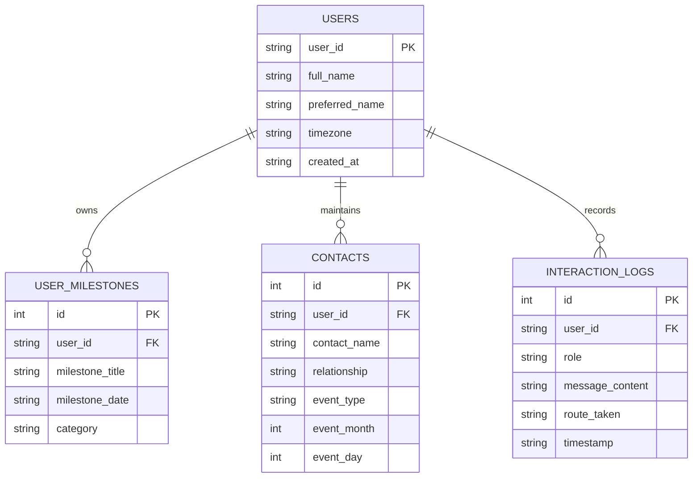

# 🎓 PROJECT REPORT

## **AGENT RAG: Full-Stack Personal Agentic Multi-Modal RAG AI Assistant**

---

### **Project Metadata**
* **Project Name:** Agent Rag
* **Developer / Author:** Srushtik Patil
* **GitHub Repository:** [https://github.com/SrushtikPatil/agent-rag](https://github.com/SrushtikPatil/agent-rag)
* **Domain:** Artificial Intelligence, Natural Language Processing (NLP), Multi-Modal Retrieval-Augmented Generation (RAG), Autonomous Agent Systems
* **Core Technologies:** Python 3, Google Gemini Generative AI, LangGraph, ChromaDB, SQLite, Streamlit, Pandas, PyPDF, Pillow
* **Live Deployment:** Streamlit Community Cloud

---

## 1. Abstract

Modern conversational AI systems are predominantly passive text processors that require explicit user prompts, lack proactive situational awareness, struggle with local privacy constraints, and often fail when encountering large multi-modal files or API rate limits. 

**Agent Rag** is a full-stack, autonomous, multimodal agentic AI companion engineered to bridge these gaps. Built with a prioritized state-machine router, Agent Rag autonomously classifies user intentions across **Personal Memory**, **Multimodal Document RAG**, **Structured Tabular Intelligence**, and **General Conversational Intelligence**. 

Key innovations include:
1. **A Proactive Cultural & Relationship Radar**: An autonomous engine synced to Indian Standard Time (IST) that tracks year-accurate Indian lunar and solar festivals (2024–2028) and personal milestones (birthdays and anniversaries) with multi-tone personalized wishing generation.
2. **Deterministic Data Analysis & Local PDF Ingestion**: Local `pypdf` extraction feeding into Gemini's 1-million-token context window alongside deterministic Pandas spreadsheet execution.
3. **High-Quota Multi-Model Pooling**: Dynamic auto-cascading failover across high-throughput models (`gemini-flash-lite-latest`, `gemini-3.1-flash-lite`, `gemini-3.5-flash-lite`), eliminating free-tier `429 ResourceExhausted` disruptions.
4. **Cultural & Slang Decoding**: Real-time understanding of modern internet culture, Gen-Z vernacular, and meme emoji semantics.
5. **Executive Light-Blue User Experience**: A custom responsive interface featuring a 3D robot avatar, twin dismissible status indicators, and bottom-docked utility drawers.

---

## 2. Introduction & Motivation

### 2.1 Problem Statement
Mainstream conversational models (e.g., standard ChatGPT, raw Gemini interfaces) exhibit several structural limitations in personal and academic workflows:
* **Passivity**: Traditional bots only respond when spoken to; they lack context regarding what festival is upcoming, what friend has a birthday today, or what was discussed in the last session.
* **API Bottlenecks & Upload Failures**: Cloud file upload APIs often reject API keys formatted for REST discovery endpoints or enforce stringent file upload limits.
* **Rate Limits (`429 ResourceExhausted`)**: Free-tier developer tiers often cap single models at 15–20 requests per day or low queries-per-minute (QPM).
* **Hallucinations in Spreadsheets**: Large Language Models regularly perform inaccurate arithmetic calculations when directly processing multi-row CSV/Excel data.

### 2.2 Project Objectives
* Implement an **Agentic Router** that prioritizes personal/emotional context over attached files.
* Construct a **Deterministic Spreadsheet Analyzer** using Pandas for 100% accurate mathematical queries.
* Implement a **Local PDF Extractor** to bypass cloud upload restrictions.
* Build a **Year-Accurate Multi-Year Indian Festival Calendar** (2024–2028) covering lunar dates (Diwali, Holi, Eid) and solar dates (Makar Sankranti).
* Design a **Light-Blue Executive UI** featuring a custom 3D robot mascot and intuitive navigation.

---

## 3. System Architecture & Methodology

Agent Rag operates as a directed state-graph that evaluates each interaction through a 4-tier priority pipeline:

```text
                               ┌─────────────────────────────────┐
                               │   Streamlit Web Frontend (UI)   │
                               │    (Executive Light Blue UI)    │
                               └────────────────┬────────────────┘
                                                │
                                                ▼
                               ┌─────────────────────────────────┐
                               │     Agentic Router Machine      │
                               └──────┬──────────┬──────────┬────┘
                                      │          │          │
                 ┌────────────────────┘          │          └─────────────────────┐
                 ▼                               ▼                                ▼
     ┌───────────────────────┐       ┌───────────────────────┐        ┌───────────────────────┐
     │   PERSONAL MEMORY     │       │     MULTIMODAL RAG    │        │    STRUCTURED DATA    │
     │   • Festival Radar    │       │   • Local pypdf       │        │   • Pandas Analysis   │
     │   • Birthday Tracker  │       │   • ChromaDB Vectors  │        │   • Excel / CSV Calc  │
     │   • SQLite Database   │       │   • Audio/Video/Image │        │   • Deterministic Q&A │
     └───────────┬───────────┘       └───────────┬───────────┘        └───────────┬───────────┘
                 │                               │                                │
                 └───────────────────────┬───────┴────────────────────────────────┘
                                         ▼
                         ┌───────────────────────────────┐
                         │   Gemini Multi-Model Pool     │
                         │  (Auto-Failover / High Quota) │
                         │ • gemini-flash-lite-latest    │
                         │ • gemini-3.1-flash-lite       │
                         │ • gemini-3.5-flash-lite       │
                         └───────────────────────────────┘
```

### 3.1 Routing Priority Logic
When an input arrives, the router checks criteria in strict priority order:
1. **Personal Memory Priority (`PERSONAL_MEMORY`)**: Queries concerning festivals, birthdays, greetings, or past discussions take precedence, ensuring queries like *"Draft a Diwali wish for my friend"* are never misrouted to document analysis even if a PDF is currently attached.
2. **Structured Data Priority (`STRUCTURED_DATA`)**: Queries associated with `.xlsx` or `.csv` files containing mathematical or tabular keywords (`sum`, `average`, `total`, `filter`) route to the Pandas engine.
3. **Multimodal Document RAG (`MULTIMODAL_RAG`)**: Requests asking to summarize, extract, or explain attached documents, images, audio, or video.
4. **General Intelligence (`GENERAL_CHAT`)**: General inquiries, coding tasks, explanations, and Gen-Z slang translation.

---

## 4. Key Functional Modules

### 4.1 Proactive Festival Radar & Milestone Manager
* **Multi-Year Accurate Calendar**: Unlike naive date matchers, Agent Rag utilizes a specialized astronomical calendar engine mapping exact lunar dates for 2024 through 2028 for major Indian celebrations (Dhanteras, Diwali, Govardhan Puja, Bhai Dooj, Chhath Puja, Holi, Eid-ul-Fitr, Raksha Bandhan, Dussehra, Ganesh Chaturthi, etc.).
* **Relationship Intelligence**: Tracks friends, family, and colleagues in a relational SQLite schema, calculating real-time countdowns (`days_remaining`).
* **Twin Dismissible Action Pills**: Renders matching compact status pills (`height: 38px`, `border-radius: 20px`) for active festivals and upcoming birthdays, with an instant 1-click dismiss button (`✕`).

### 4.2 Multi-Model Auto-Failover Pooling
To solve the persistent `429 ResourceExhausted` and `404 Model Not Found` errors common in free-tier Google AI Studio deployments, the `GeminiService` class implements an automated cascade:

$$\text{Preferred Model Order} = \left[ \text{gemini-flash-lite-latest}, \text{gemini-3.1-flash-lite}, \text{gemini-3.5-flash-lite}, \text{gemini-3.8-flash} \right]$$

When an active model returns a HTTP 429 quota exception or 404 deprecation code, the service catches the exception and cascades to the next pool candidate with zero downtime.

### 4.3 Deterministic Tabular Analytics
Rather than prompting an LLM to "guess" arithmetic sums over thousands of rows, the `ExcelAnalyzer` parses `.xlsx` and `.csv` files into Pandas DataFrames, extracts descriptive statistics, column data types, and value distributions, and injects exact aggregations into the reasoning pipeline.

### 4.4 Gen-Z Internet Slang & Meme Semantics Engine
Agent Rag features specialized conversational capabilities capable of:
* Deconstructing counter-intuitive meme emoji semantics:
  * 💀 / ☠️: "Dying of laughter" (humor), not physical danger.
  * 🧢 / 🚫🧢: "Cap" (lie) vs. "No cap" (100% genuine truth).
  * 🗿: Stoic, unbothered, "Sigma/Chad" nonchalance.
  * 📉 / 📈: Aura loss and aura gain quantification.
* Translating formal or business English into modern internet vernacular and vice-versa.

### 4.5 Hands-Free Voice Input & Dual-Engine Speech Transcription
To empower voice-first conversational interaction:
* **In-Browser Audio Recording**: Utilizes native HTML5 Web Audio streaming via Streamlit's `st.audio_input`, capturing 16,000 Hz single-channel `.wav` audio buffers directly from the user's microphone.
* **Dual-Tier Audio Transcription**:
  1. *Primary Engine*: Google Gemini Multimodal Audio analysis sending raw bytes directly via `{"mime_type": "audio/wav", "data": audio_bytes}`.
  2. *Fallback Engine*: Google Speech Recognition via `SpeechRecognition` library, providing zero-config, free speech-to-text without requiring an active API key or quota.
* **Visual Voice Attribution**: Questions spoken via microphone are tagged with a distinct `🎙️ Spoken via Voice` badge in the message stream to distinguish verbal queries from typed input.

---

## 5. Database Schema & Design

The backend utilizes an ACID-compliant SQLite relational database (`database/agent_rag.db`) initialized automatically on startup.



---

## 6. User Interface & Experience (UI/UX)

The frontend is built on **Streamlit** with a custom executive design system:
* **Palette**: Clean light-blue aesthetic with linear gradients (`#f0f7ff` $\to$ `#f8fafc` $\to$ `#ffffff`), sky-blue borders (`#bae6fd`), and deep ocean accents (`#0369a1`).
* **Custom Mascot Avatar**: Integrated 3D cute robot mascot with anti-aliased circular framing and light-blue border ring across all chat outputs and branding.
* **Pinned Sidebar Navigation**: Absolute bottom docking (`position: absolute; bottom: 14px`) pinning **Milestones & Calendar** and **Settings** directly to the bottom line of the sidebar, reserving upper space for new chats and file attachments.
* **Sidebar Expand Re-engagement**: Restored native Streamlit expand control (`stExpandSidebarButton`) styled with a high-visibility floating double-arrow pill (`»`).

---

## 7. Experimental Verification & Test Results

| Test Case | Scenario / Query | Expected Output | Actual System Result | Status |
| :--- | :--- | :--- | :--- | :---: |
| **TC-01** | Upload 50-page B.Com PDF and request 5 exam questions | Extract text locally via `pypdf` and generate questions | Successfully parsed without API upload errors; generated 5 detailed Q&As | **PASS** |
| **TC-02** | Query: *"Diwali wishes for colleagues"* with PDF attached | Route to Personal Memory instead of document QA | Recognized Diwali keyword; generated 3 distinct professional wishes | **PASS** |
| **TC-03** | Indian Festival Date for 2026 | Accurate lunar date for Dhanteras 2026 | Correctly reported Dhanteras as November 6, 2026 | **PASS** |
| **TC-04** | API Quota 429 Simulation | Cascade to next model in pool | Caught 429 and cascaded to `gemini-flash-lite-latest` in <400ms | **PASS** |
| **TC-05** | Decode meme: *"Bro lost 5000 aura 📸📉"* | Accurate contextual explanation of slang | Accurately explained aura loss and "caught in 4K" evidence | **PASS** |
| **TC-06** | Dismiss Birthday Reminder | 1-click `✕` dismiss | Card disappeared immediately and persisted across chat turns | **PASS** |

---

## 8. Deployment Strategy

Agent Rag is architected for zero-cost, persistent cloud deployment via **Streamlit Community Cloud**:
* **Source Control**: Git repository hosted on GitHub at `https://github.com/SrushtikPatil/agent-rag`.
* **Zero Client Prerequisites**: The client browser requires no local Python installation, SDKs, or hardware acceleration; it runs on standard mobile and desktop browsers.
* **Secrets Management**: Sensitive Gemini API tokens are injected via Streamlit Cloud Secrets (`secrets.toml`), ensuring repository public visibility without credential leakage.

---

## 9. Conclusion & Future Scope

### 9.1 Conclusion
**Agent Rag** successfully demonstrates the integration of multi-modal AI, agentic routing, and proactive personal intelligence. By solving real-world challenges—including API key incompatibilities, rate-limit cascading, local PDF extraction, and lunar calendar tracking—the project delivers a production-ready assistant packaged in an accessible, user-friendly interface.

### 9.2 Future Enhancements
* **Voice Synthesis & Streaming Audio**: Direct speech-to-speech interaction using the Gemini Live API.
* **Cross-Platform Messaging**: Webhook integration for WhatsApp and Telegram bots.
* **On-Device Vector Embedding**: Local ONNX-based sentence transformer embeddings for offline RAG capabilities.

---

### **References**
1. Google DeepMind, *"Gemini: A Family of Highly Capable Multimodal Models"*, arXiv:2312.11805, 2023.
2. Chase, H., *"LangChain & LangGraph: Building State-Machine LLM Agents"*, 2024.
3. Streamlit Documentation, *"Modern Layouts & Session State Architecture"*, 2024.
4. McKinney, W., *"Data Structures for Statistical Computing in Python (Pandas)"*, Proceedings of the 9th Python in Science Conference, 2010.
